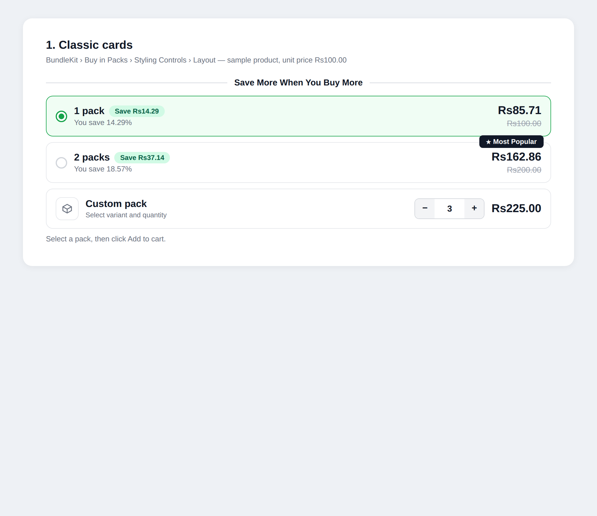
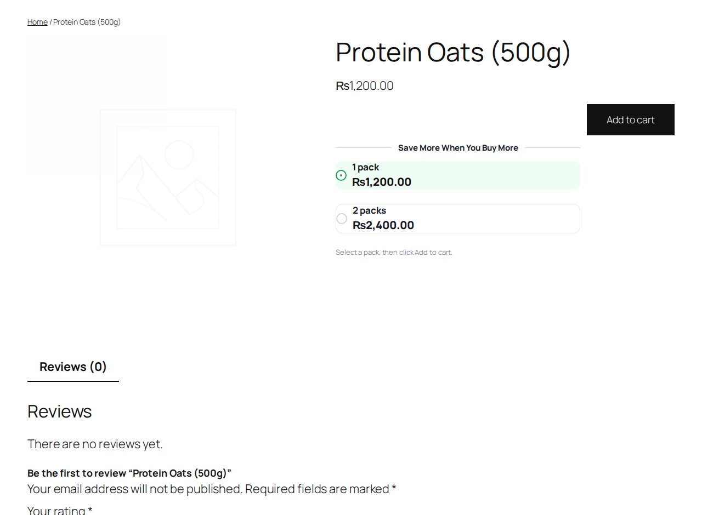
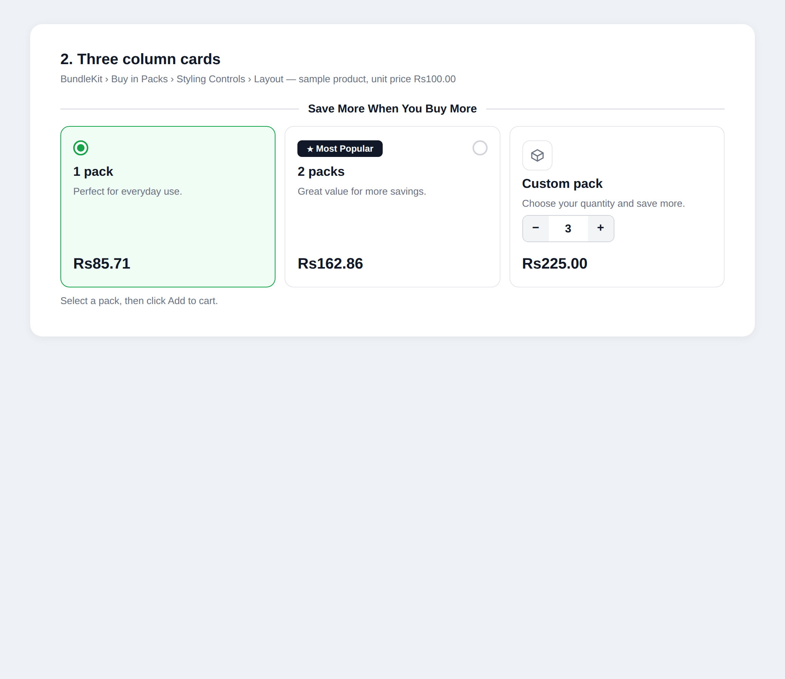
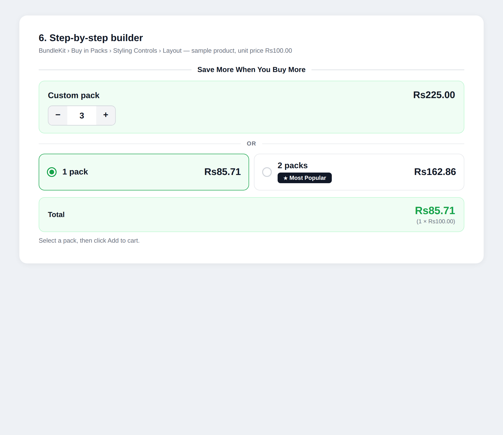

# BundleKit – Buy in Packs

**Tiered quantity packs with per-pack discounts — buy more, save more.**

Free and open source. Version 1.6.0.

   

Sell any product in quantity packs with per-pack discounts. Shoppers pick a pack — or build a custom quantity — and see exactly what they save before adding to cart. A fresh install shows a 1-pack and a 2-pack on every product with zero setup.

> There is no separate BundleKit plugin to install. The BundleKit framework is bundled inside this plugin — install and activate just this one.

## Contents

1. [What it is used for](#what-it-is-used-for)
2. [Screenshots](#screenshots)
3. [Features](#features)
4. [Installation and quick start](#installation-and-quick-start)
5. [Pack setup](#pack-setup)
6. [Layouts](#layouts)
7. [Global settings reference](#global-settings-reference)
8. [FAQ and troubleshooting](#faq-and-troubleshooting)
9. [Version history and roadmap](#version-history-and-roadmap)
10. [Support and license](#support-and-license)

## What it is used for

| Use case | How |
|---|---|
| **Bulk consumables** | Coffee, supplements or cleaning refills in 1, 2 and 5-packs with rising discounts. |
| **Wholesale tiers** | Bigger packs at better unit prices without a separate wholesale plugin. |
| **Family packs** | One product page, several household-size options. |
| **Intro offers** | A discounted 1-pack next to full-price larger packs. |

## Screenshots

### Storefront

**Classic cards** live on a product page: pick a pack, see the savings, add to cart.

### Layouts

| | |
|---|---|
|  **Classic cards**: pack rows with savings badges |  **Three column cards**: visual cards for easy comparison |
|  **Step-by-step builder**: quantity stepper with live total | |

## Features

**Storefront**
- 3 layouts: Classic cards, Three column cards, Step-by-step builder — picked globally, switchable anytime.
- Per-pack discounts with "Save Rs X" / "You save N%" badges and struck regular prices.
- "Most Popular" badge on a chosen pack.
- Optional Custom pack card: the shopper picks any quantity between your min and max.
- Live total updates as the shopper changes quantity.

**Pack setup**
- Global Default Packs: a 1-pack (qty 1) and a 2-pack (qty 2) appear on every product out of the box — 0% discount, fully editable.
- Settings > **Default Packs** repeater and **Custom Pack** card (on/off, label, min/max/step/discount; off by default).
- Per product, **Pack source**: Use global packs (default), Custom packs for this product, or No packs on this product.
- Resolution order: master kill-switch → product disabled → product custom → global.
- A Fixed Bundle offer on the same product wins over packs.

**Quality**
- No external requests, tracking or telemetry. Nonce checks on settings saves; escaped output.

## Installation and quick start

1. Upload the ZIP at **Plugins > Add New Plugin > Upload Plugin** and activate (WooCommerce must be active).
2. Every product already shows the global 1-pack and 2-pack — open a product page to see them.
3. Tune discounts under **BundleKit > Buy in Packs > Settings**, or set per-product packs in the product editor.

## Pack setup

1. **BundleKit > Buy in Packs > Settings**: edit the Default Packs (quantities, discounts, badges) and optionally enable the Custom Pack card.
2. For a product with its own packs: edit the product, set **Pack source** to "Custom packs for this product" and define them.
3. To hide packs on a product: set **Pack source** to "No packs on this product".

## Layouts

- **Classic cards**: one row per pack with the savings badge and struck price — the default.
- **Three column cards**: visual cards side by side for easy comparison.
- **Step-by-step builder**: a quantity stepper on top with a live total below.

Pick the layout under Styling Controls; the preview updates live before you save.

## Global settings reference

| Area | Controls |
|---|---|
| Settings | Master on/off kill-switch, Default Packs repeater, Custom Pack card |
| Styling Controls | Layout picker with live preview, colors and typography |
| Product editor | Pack source: Use global packs / Custom packs for this product / No packs on this product |

## FAQ and troubleshooting

**Packs appear on a product I never set up.** That is the global Default Packs — they show on every product by design. Set that product's Pack source to "No packs on this product" to hide them.

**I changed the layout but the product page still shows the old one.** Save the settings, clear any page cache, and in Elementor go to Tools > Regenerate Files & Data.

**A product has both a Fixed Bundle and packs.** The Fixed Bundle wins; packs are hidden on that product.

**I updated the plugin but the old version still seems to run.** Check the version on the Plugins screen. If the files did not actually replace, re-upload the ZIP with "Replace current with uploaded" and restart Apache (to clear OPcache).

## Version history and roadmap

| Version | Highlights |
|---|---|
| **1.6.0** | Trimmed to 3 layouts (Classic cards, Three column cards, Step-by-step builder) |
| **1.4.1** | Fix: fatal on the Styling Controls preview |
| **1.3.0** | Global Default Packs: 1-pack and 2-pack on every product with zero setup |
| **1.0.0** | Initial release: tiered packs, per-pack discounts, layouts |

**Roadmap:** more BundleKit add-ons (Mix-and-match / BYOB, Build-a-box).

## Support and license

Ideas and bug reports: open a GitHub issue, or email **safiqkhan0102@gmail.com**. Author: Shafiqur Rehman.

MIT. See `LICENSE`. (The plugin header also carries `GPLv2 or later` for WordPress.org compatibility.)
